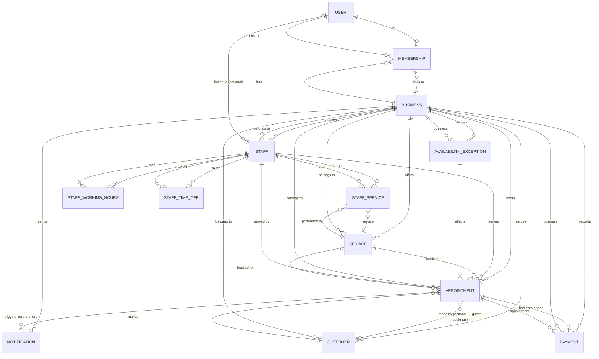

# ServeFlow — Database Design

**Version:** 1.0 (Phase 1 — Planning)  
**Status:** Draft  
**Database:** PostgreSQL  
**ORM:** Prisma  
**Developed by:** Zentravi Engineering

---

## 1. Design principles

- **Single database, multi-tenant:** all businesses share one PostgreSQL database. Tenant isolation is enforced by `businessId` scoping on every business-owned table, plus application-layer authorization (never client-trusted IDs).
- **Timezone-aware:** all stored timestamps are `timestamptz` (UTC). Business operating hours and staff working hours are stored as local time-of-day relative to the business timezone; slot calculation converts to UTC for storage/comparison.
- **Correct relationships:** foreign keys, indexes on foreign keys, unique constraints where needed, sensible cascade rules (soft-delete preferred for audit safety; hard-cascade only for truly disposable data).
- **Timestamps:** `createdAt` and `updatedAt` on every entity.
- **Deletion policy:** soft-delete (`deletedAt`) on core business records (business, staff, service, customer, appointment) so history and audit trails survive; hard delete only for ephemeral tokens and verification codes.

---

## 2. Entity-relationship diagram (Mermaid)



### 2.1 Illustrative Prisma Model Snippets

**These snippets are illustrative only.** They follow Prisma syntax conventions but have NOT been validated with `prisma validate`. No `schema.prisma` file exists in the repository yet. Do not treat these as an executable schema.

```prisma
model User {
  id                        String   @id @default(cuid())
  email                     String   @unique
  passwordHash              String
  name                      String
  imageUrl                  String?
  emailVerified             Boolean  @default(false)
  emailVerifiedAt           DateTime?
  emailVerificationToken    String?
  emailVerificationTokenExpires DateTime?
  passwordResetToken        String?
  passwordResetTokenExpires DateTime?
  platformRole              PlatformRole @default(USER)
  createdAt                 DateTime @default(now())
  updatedAt                 DateTime @updatedAt

  memberships               Membership[]
  staffProfiles             Staff[]
}

model Business {
  id                String   @id @default(cuid())
  name              String
  slug              String   @unique
  email             String?
  phone             String?
  address           String?
  timezone          String   @default("Asia/Kolkata")
  operatingHours    Json
  isPublicBookingEnabled Boolean @default(true)
  logoUrl           String?
  status            BusinessStatus @default(ACTIVE)
  createdAt         DateTime @default(now())
  updatedAt         DateTime @updatedAt
  deletedAt         DateTime?

  memberships       Membership[]
  staff             Staff[]
  services          Service[]
  customers         Customer[]
  appointments      Appointment[]
  payments          Payment[]
  notifications     Notification[]
  availabilityExceptions AvailabilityException[]
}

model Membership {
  id        String   @id @default(cuid())
  userId    String
  businessId String
  role      MembershipRole
  createdAt DateTime @default(now())

  user    User    @relation(fields: [userId], references: [id])
  business Business @relation(fields: [businessId], references: [id])

  @@unique([userId, businessId])
}

model Staff {
  id        String   @id @default(cuid())
  businessId String
  userId    String?
  name      String
  email     String
  phone     String?
  role      String
  bio       String?
  imageUrl  String?
  isActive  Boolean   @default(true)
  createdAt DateTime  @default(now())
  updatedAt DateTime  @updatedAt

  user      User?     @relation(fields: [userId], references: [id])
  business  Business  @relation(fields: [businessId], references: [id])
  staffServices StaffService[]
  workingHours StaffWorkingHours[]
  timeOff   StaffTimeOff[]
  appointments Appointment[]

  @@unique([id, businessId])
  @@unique([businessId, userId], name: "Staff_businessId_userId_key", map: "staff_business_user_unique")
}

model StaffService {
  id        String   @id @default(cuid())
  staffId   String
  businessId String
  serviceId String
  createdAt DateTime @default(now())

  staff   Staff    @relation(fields: [staffId, businessId], references: [id, businessId])
  service Service  @relation(fields: [serviceId, businessId], references: [id, businessId])

  @@unique([staffId, serviceId, businessId])
}

model StaffWorkingHours {
  id        String   @id @default(cuid())
  staffId   String
  businessId String
  dayOfWeek Int
  startTime String
  endTime   String
  isWorking Boolean  @default(true)
  createdAt DateTime @default(now())

  staff Staff @relation(fields: [staffId, businessId], references: [id, businessId])

  @@unique([staffId, businessId, dayOfWeek])
}

model StaffTimeOff {
  id        String   @id @default(cuid())
  staffId   String
  businessId String
  startTime DateTime
  endTime   DateTime
  reason    String?
  createdAt DateTime @default(now())

  staff Staff @relation(fields: [staffId, businessId], references: [id, businessId])
}

model Service {
  id        String   @id @default(cuid())
  businessId String
  name      String
  description String?
  price     Decimal
  durationMinutes Int
  bufferMinutes Int  @default(0)
  isActive  Boolean  @default(true)
  createdAt DateTime @default(now())
  updatedAt DateTime @updatedAt

  business      Business     @relation(fields: [businessId], references: [id])
  staffServices StaffService[]
  appointments  Appointment[]

  @@unique([id, businessId])
}

model Customer {
  id        String   @id @default(cuid())
  businessId String
  name      String
  email     String
  phone     String?
  notes     String?
  createdAt DateTime @default(now())
  updatedAt DateTime @updatedAt

  business   Business   @relation(fields: [businessId], references: [id])
  appointments Appointment[]
  payments   Payment[]

  @@unique([id, businessId])
  @@unique([businessId, email], name: "Customer_businessId_email_key")
}

model Appointment {
  id                 String          @id @default(cuid())
  businessId         String
  customerId         String?
  staffId            String
  serviceId          String
  startTime          DateTime
  endTime            DateTime
  status             AppointmentStatus @default(PENDING)
  price              Decimal
  customerName       String?
  customerEmail      String?
  customerPhone      String?
  notes              String?
  cancelledAt        DateTime?
  cancellationReason String?
  createdAt          DateTime @default(now())
  updatedAt          DateTime @updatedAt
  deletedAt          DateTime?

  business   Business    @relation(fields: [businessId], references: [id])
  customer   Customer?   @relation(fields: [customerId, businessId], references: [id, businessId])
  staff      Staff       @relation(fields: [staffId, businessId], references: [id, businessId])
  service    Service     @relation(fields: [serviceId, businessId], references: [id, businessId])
  payments   Payment[]
  notifications Notification[]

  @@unique([id, businessId])
}

model Payment {
  id               String       @id @default(cuid())
  businessId       String
  appointmentId    String
  amount           Decimal
  currency         String       @default("INR")
  status           PaymentStatus @default(PENDING)
  provider         String?
  providerPaymentId String?
  createdAt        DateTime    @default(now())
  updatedAt        DateTime    @updatedAt

  business Business   @relation(fields: [businessId], references: [id])
  appointment Appointment @relation(fields: [appointmentId, businessId], references: [id, businessId])

  @@unique([appointmentId], name: "Payment_appointmentId_key")
}

model Notification {
  id          String        @id @default(cuid())
  businessId  String
  appointmentId String
  channel     NotificationChannel
  recipient   String
  type        NotificationType
  subject     String?
  content     String
  status      NotificationStatus @default(PENDING)
  sentAt      DateTime?
  createdAt   DateTime @default(now())

  business Business   @relation(fields: [businessId], references: [id])
  appointment Appointment @relation(fields: [appointmentId, businessId], references: [id, businessId])
}

model AvailabilityException {
  id        String   @id @default(cuid())
  businessId String
  startTime DateTime
  endTime   DateTime
  title     String?
  isClosed  Boolean  @default(true)
  createdAt DateTime @default(now())

  business Business @relation(fields: [businessId], references: [id])
}

model AuditLog {
  id          String   @id @default(cuid())
  businessId  String?
  userId      String?
  action      String
  entityType  String
  entityId    String
  oldValues   Json?
  newValues   Json?
  ipAddress   String?
  userAgent   String?
  createdAt   DateTime @default(now())

  business Business? @relation(fields: [businessId], references: [id])
  user     User?     @relation(fields: [userId], references: [id])
}
```

**Prisma syntax notes:**
- Composite unique constraints use `@@unique([fieldA, fieldB])` — supported natively.
- Composite foreign keys use relation fields with `@relation(fields: [...], references: [...])` — NOT `@@foreignKey`.
- The referenced model must have a unique constraint covering the referenced fields (e.g., `@@unique([id, businessId])` on `Staff`).
- Exclusion constraints (`EXCLUDE USING gist`) cannot be expressed in Prisma schema. The `appointment_no_overlap` constraint requires a raw SQL migration.
- Both sides of each relation are shown (e.g., `User.staffProfiles` and `Staff.user`).

**Note on appointment status history:** Appointment status changes are recorded in `AuditLog` with `entityType = 'Appointment'`, `action = 'status_change'`, and `oldValues`/`newValues` capturing the before/after status. There is no separate `AppointmentStatusHistory` entity; `AuditLog` serves as the immutable status-change audit trail. A dedicated `AppointmentStatusHistory` table remains an open decision if more granular status transition tracking is needed.
```

---

## 3. Entity details

### 3.1 User
Platform-level account. One user can belong to multiple businesses via memberships.

- `email` is unique globally (login identifier).
- `passwordHash` — bcrypt.
- `platformRole` — Platform-level role: `SUPER_ADMIN` or `USER`. Separate from business-scoped `MembershipRole`. `SUPER_ADMIN` users can access the super-admin platform interface across all tenants; `USER` is the default for ordinary business users. Authorization is enforced server-side via a `SuperAdminGuard` that checks `platformRole = SUPER_ADMIN`, independent of any business membership.
- `emailVerificationToken` / `passwordResetToken` — single-use, time-limited.

### 3.2 Business
The tenant. Every business-owned record references `businessId`.

- `slug` — unique, used for public booking portal URLs (e.g. `serveflow.app/b/{slug}`).
- `operatingHours` — JSON map of day-of-week (0–6) → array of open/close intervals `{ open: "HH:MM", close: "HH:MM" }`. All times are local to `timezone`.
- `timezone` — IANA zone (e.g. `Asia/Kolkata`). All stored timestamps are UTC (`timestamptz`); slot calculation converts business-local operating hours to UTC for comparison.
- `status` — `ACTIVE` | `SUSPENDED` | `CLOSED`.
- `deletedAt` — soft delete.

### 3.3 Membership
Links User → Business with a role: `OWNER` | `ADMIN` | `STAFF` | `VIEWER`.

- `(userId, businessId)` unique — prevents duplicate memberships.

### 3.4 Staff
Employee profile within a business. Optional link to a `User` account (staff who log in).

- `userId` is **nullable**. A staff member can exist without a login account (e.g., a contractor who doesn't need platform access).
- **User → Staff:** One User may have staff profiles at multiple businesses (one-to-many via `Staff.staffProfiles` on User).
- **Staff → User:** A Staff profile may have no linked User (nullable `userId`). The relationship is many-to-one: many Staff profiles can link to the same User, but each Staff profile references at most one User.
- **Per-business uniqueness:** `@@unique([businessId, userId])` prevents duplicate staff profiles for the same user within the same business. Multiple staff profiles with `null` userId can exist for the same business.
- `isActive` — whether staff can take new bookings.

### 3.5 StaffService
Many-to-many: which services a staff member is qualified to perform.

### 3.6 StaffWorkingHours
Recurring weekly schedule: `dayOfWeek` (0–6), `startTime` (local time `HH:MM`), `endTime` (local time `HH:MM`), `isWorking` flag. All times are stored in the business's timezone and converted to UTC at slot-calculation time.

### 3.7 StaffTimeOff
One-off absences (vacation, sick, personal): `startTime` and `endTime` stored as UTC `timestamptz`. These override normal working hours for the affected period.

### 3.8 Service
Bookable offering: name, description, price, duration, optional booking buffer, active/inactive.

### 3.9 Customer
Directory entry per business. `email` unique within a business (not globally — same customer may appear at multiple businesses).

### 3.10 Appointment
The core booking record.

- `startTime` / `endTime` — UTC timestamps. `endTime` = `startTime` + service duration + service buffer. The buffer is included in the occupied interval so no other booking can start during the buffer period.
- `status` — `PENDING` | `CONFIRMED` | `COMPLETED` | `CANCELLED` | `NO_SHOW`.
- `price` — snapshot of service price at booking time.
- `customerId` is **nullable** (Option A: optional). This supports guest bookings where no `Customer` record exists yet. When `customerId` is null, `customerName/Email/Phone` snapshot fields capture the guest's details.
- `customerName/Email/Phone` — snapshot for guest bookings (portal) where no customer record exists yet.
- `deletedAt` — soft-delete column present for schema consistency; appointments are logically removed by setting `status = CANCELLED` rather than hard-deleting, preserving history and audit trails.

**Decision rationale (Option A over Option B):** Making `customerId` optional avoids forcing Customer record creation during the public booking flow. The appointment already carries snapshot contact fields, so a Customer record can be created later (e.g., when the customer returns) without data loss. This keeps the booking submission simple and transactionally safe.

### 3.11 Payment
Payment record linked to an appointment. `status`: `PENDING` | `PAID` | `REFUNDED` | `FAILED`. Modular — provider fields optional.

- **No redundant `customerId` field.** The customer is derived through `appointment.customerId`. Payment does not store a direct customer reference, eliminating the risk of a payment referencing a customer different from its appointment's customer or from another business.
- `appointmentId` is unique — one payment per appointment.
- Cross-business integrity: `Payment` references `Appointment(id, businessId)` via composite FK, preventing payment for another business's appointment.

### 3.12 Notification
Outbound notification record (email/SMS/in-app) tied to an appointment.

### 3.13 AvailabilityException
Business-level closures (holidays, emergencies): `startTime`/`endTime` stored as UTC `timestamptz`, `isClosed` flag, optional `title`. Overrides normal operating hours for the affected period. Times are converted from business-local to UTC at storage time.

### 3.14 AuditLog
Immutable append-only record of state-changing actions: who, what, when, old/new values, IP, user agent.

---

## 4. Indexing strategy

| Table | Index | Reason |
|-------|-------|--------|
| `user` | unique `email` | Login lookup |
| `membership` | `(userId, businessId)` unique | Membership lookup + dedupe |
| `membership` | `businessId` | List members of a business |
| `business` | unique `slug` | Public portal resolution |
| `staff` | `businessId` | Staff directory per business |
| `staff` | `(businessId, userId)` unique | One user account → one staff profile per business |
| `staff_service` | `(staffId, serviceId)` unique | Service assignment dedupe |
| `service` | `businessId` | Service catalog per business |
| `service` | `(businessId, isActive)` | Active services list |
| `customer` | `businessId` | Customer directory per business |
| `customer` | `(businessId, email)` unique | Customer lookup per business |
| `appointment` | `businessId` | All appointments for business |
| `appointment` | `(businessId, startTime)` | Calendar range queries |
| `appointment` | `(businessId, status, startTime)` | Dashboard filters by status + date |
| `appointment` | `(staffId, startTime)` | Staff schedule queries |
| `appointment` | `(customerId, businessId)` | Customer history |
| `payment` | `businessId` | Revenue queries |
| `payment` | `appointmentId` unique | One payment per appointment |
| `notification` | `businessId` | Notification list |
| `audit_log` | `businessId` | Audit trail per business |
| `availability_exception` | `businessId` | Business closures |
| `staff_time_off` | `staffId` | Staff absences |
| `staff_working_hours` | `staffId` | Staff weekly schedule |

---

## 5. Constraints & deletion behavior

- **Foreign keys:** all `businessId`, `userId`, `staffId`, `serviceId`, `customerId`, `appointmentId` references enforced with `ON DELETE CASCADE` where the child record has no meaning without the parent (e.g. `StaffService`, `StaffWorkingHours`, `StaffTimeOff`, `Payment`, `Notification`, `AuditLog`, `AvailabilityException`).
- **Appointments:** `ON DELETE SET NULL` / restrict delete; cancellations set `status = CANCELLED` rather than deleting, preserving history.
- **Users:** `ON DELETE CASCADE` to memberships; soft-delete preferred.
- **Businesses:** soft-delete via `deletedAt`; hard delete only in admin tooling with cascade to dependent records.

### 5.5 Database-level tenant integrity (composite foreign keys)

Composite foreign keys prevent cross-business record references at the database layer:

| Table | Composite FK | References | Prevents |
|-------|-------------|------------|----------|
| `Appointment` | `(staffId, businessId)` | `Staff(id, businessId)` | Booking staff from another business |
| `Appointment` | `(serviceId, businessId)` | `Service(id, businessId)` | Booking services from another business |
| `Appointment` | `(customerId, businessId)` | `Customer(id, businessId)` | Booking customers from another business |
| `StaffService` | `(staffId, businessId)` | `Staff(id, businessId)` | Linking staff from another business |
| `StaffService` | `(serviceId, businessId)` | `Service(id, businessId)` | Linking services from another business |
| `Payment` | `(appointmentId, businessId)` | `Appointment(id, businessId)` | Payment for another business's appointment |
| `Notification` | `(appointmentId, businessId)` | `Appointment(id, businessId)` | Notification for another business's appointment |

Referenced tables require unique constraints on `(id, businessId)`: `Staff`, `Service`, `Customer`, `Appointment`. These are declared as `@@unique([id, businessId])` in the Prisma schema.

Composite foreign keys are supported by Prisma and PostgreSQL. They provide database-level defense-in-depth alongside application-layer tenant scoping. However, tenant isolation is NOT fully database-enforced — application-layer authorization (role checks, business context resolution) remains the primary enforcement mechanism. Database constraints prevent specific cross-business FK violations but do not replace authorization middleware.

Prisma syntax notes:

- **Composite unique constraints** use `@@unique([fieldA, fieldB])` — supported natively.
- **Composite foreign keys** use relation fields with `@relation(fields: [...], references: [...])` — NOT `@@foreignKey`. For example:
  ```prisma
  staff   Staff    @relation(fields: [staffId, businessId], references: [id, businessId])
  service Service  @relation(fields: [serviceId, businessId], references: [id, businessId])
  ```
  The referenced model must have a unique constraint covering the referenced fields (e.g., `@@unique([id, businessId])` on `Staff`).
- **Exclusion constraints** (`EXCLUDE USING gist`) cannot be expressed in Prisma schema. The `appointment_no_overlap` constraint requires a raw SQL migration (see §6.5) and must be manually preserved across `prisma migrate dev` resets.

Referenced tables require unique constraints on `(id, businessId)`: `Staff`, `Service`, `Customer`, `Appointment`. These are declared as `@@unique([id, businessId])` in the Prisma schema.

Composite foreign keys are supported by Prisma and PostgreSQL via `@relation(fields:, references:)`. They provide database-level defense-in-depth alongside application-layer tenant scoping. However, tenant isolation is NOT fully database-enforced — application-layer authorization (role checks, business context resolution) remains the primary enforcement mechanism. Database constraints prevent specific cross-business FK violations but do not replace authorization middleware.

---

## 6. Concurrency & double-booking prevention

### 6.1 Problem
Two concurrent requests may both see a slot as available and attempt to create the same appointment for the same staff member at the same time.

### 6.2 Booking interval, buffer, and timezone calculation

- **Service duration**: `durationMinutes` from the `Service` record.
- **Booking buffer**: `bufferMinutes` from the `Service` record. `endTime` = `startTime` + `durationMinutes` + `bufferMinutes`. The buffer is included in the occupied interval so no overlapping booking can start during the buffer.
- **Timezone storage**: All timestamps (`startTime`, `endTime`, `StaffTimeOff`, `AvailabilityException`) are stored as UTC `timestamptz`. Business operating hours and staff working hours are stored as local `HH:MM` relative to the business `timezone`.
- **Daylight-saving transitions**: Slot calculation converts business-local operating hours and staff working hours to UTC using the business `timezone` at calculation time. DST boundary shifts are handled by the timezone library during conversion; stored UTC values are unaffected.
- **Minimum/maximum advance booking**: `Business` settings include `bookingAdvanceMin` and `bookingAdvanceMax` (in hours) to prevent booking in the past or too far in the future.

### 6.3 Slot-occupying statuses

Only appointments in `PENDING` or `CONFIRMED` status occupy a time slot and block overlapping bookings. `CANCELLED`, `COMPLETED`, and `NO_SHOW` appointments do not occupy a slot — `CANCELLED` frees the slot immediately; `COMPLETED` and `NO_SHOW` are terminal states in the past.

### 6.4 Transaction strategy

**Definitive strategy:** `SERIALIZABLE` isolation level for the booking transaction. `SELECT ... FOR UPDATE` is used only to lock existing overlapping appointment rows if any are found; it does **not** by itself prevent phantom inserts (two concurrent transactions that both see no overlapping row can both proceed to insert). The PostgreSQL exclusion constraint is the final backstop that guarantees exactly one booking per slot.

Transaction flow:
1. Open transaction with `SERIALIZABLE` isolation.
2. Validate service, business, staff exist and are active.
3. Recalculate availability server-side (operating hours, staff working hours, time off, existing appointments, service duration, buffer, timezone, selected date).
4. `SELECT ... FOR UPDATE` on existing appointments for the staff member overlapping `[startTime, endTime]` with status in (`PENDING`, `CONFIRMED`) — locks any conflicting rows if they exist.
5. If a conflicting row is found, abort with `409 Conflict`.
6. Insert the new appointment with status `PENDING`.
7. Commit. If PostgreSQL raises a serialization failure or exclusion constraint violation, abort with `409 Conflict`.

### 6.5 PostgreSQL exclusion constraint (custom SQL migration)

The `btree_gist` extension is required for the equality operator on `staffId` within a GiST index.

```sql
-- Enable btree_gist for scalar-type GiST exclusion constraints
CREATE EXTENSION IF NOT EXISTS btree_gist;

-- Prevent overlapping active appointments for the same staff member.
-- Only PENDING and CONFIRMED appointments occupy a time slot.
-- CANCELLED, COMPLETED, and NO_SHOW appointments do not block future bookings,
-- matching cancellation and rescheduling behavior.
ALTER TABLE "Appointment"
  ADD CONSTRAINT appointment_no_overlap
  EXCLUDE USING gist (
    "staffId" WITH =,
    tstzrange("startTime", "endTime") WITH &&
  )
  WHERE (status IN ('PENDING', 'CONFIRMED'));
```

This constraint is managed as a raw SQL migration file in `packages/db/prisma/migrations/`. It is reviewed during migration review, applied via `prisma migrate deploy`, and preserved across `prisma migrate dev` resets by including it in the migration history. Because Prisma cannot declaratively express `EXCLUDE USING gist`, the raw SQL must be manually re-added if a migration reset drops it. It is the database-level backstop: PostgreSQL itself rejects any overlapping active appointment for the same staff, regardless of race conditions.

### 6.6 Conflict handling

- **Exclusion violation** (overlapping active appointment for same staff): PostgreSQL raises an exclusion constraint error. The transaction is aborted; the API returns `409 Conflict` with message "This time slot is no longer available."
- **Serialization failure** (concurrent transaction modified data read by this transaction): PostgreSQL raises a serialization error. The transaction is aborted; the API returns `409 Conflict` and the client may retry with a different slot.
- **Application-level conflict** (availability check fails before insert): API returns `409 Conflict` with a specific reason (outside operating hours, staff time off, service inactive, etc.).

### 6.7 Rescheduling conflicts

Rescheduling cancels the old appointment (setting `status = CANCELLED`, freeing its time range) and creates the new appointment in the same `SERIALIZABLE` transaction. Because `CANCELLED` appointments are excluded from the exclusion constraint's `WHERE` clause, cancelling the old appointment immediately frees its slot. The exclusion constraint prevents two rescheduling operations from colliding on the same freed slot — only one will succeed, the other receives `409 Conflict`.

### 6.8 Concurrent booking attempts

When two requests target the same staff slot simultaneously:
- Both enter `SERIALIZABLE` transactions and check for overlaps.
- The first to commit inserts successfully.
- The second's insert violates the exclusion constraint (or triggers a serialization failure); PostgreSQL rejects it.
- Exactly one insert succeeds; the other receives a `409 Conflict`.

### 6.9 Testing

Integration tests cover: concurrent booking requests (exactly one success, N conflicts), exclusion constraint enforcement, rescheduling conflicts, DST boundary slot calculations, buffer enforcement, serialization failure handling, and cancelled-appointment slot release.

---

## 7. Status transitions (appointment)

Allowed transitions (server-validated state machine):

```
PENDING  → CONFIRMED
PENDING  → CANCELLED
PENDING  → NO_SHOW
CONFIRMED → COMPLETED
CONFIRMED → CANCELLED
CONFIRMED → NO_SHOW
```

COMPLETED, CANCELLED, NO_SHOW are terminal. Any other transition returns `409 Conflict`.

---

## 8. Seed data (demo)

Realistic fictional data for demonstration: one demo business ("Lumina Salon & Studio"), 4 staff, 8 services, 20 customers, 30 appointments across statuses, payments, notifications. Clearly marked as seed data — not real customer information.

---

## 9. Migrations

Prisma migrations live in `packages/db/prisma/migrations/`. Each migration is reviewed and applied via `prisma migrate deploy` in CI and locally in dev. No manual `CREATE TABLE` outside Prisma.
